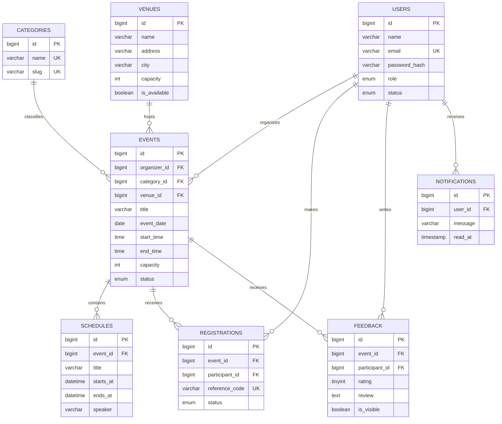

# Event Management System — ER Diagram

Registration and feedback each have a unique `(event_id, participant_id)` constraint. Event capacity and venue time conflicts are checked by transactional/application validation; MySQL does not provide a simple cross-row constraint for either rule.
